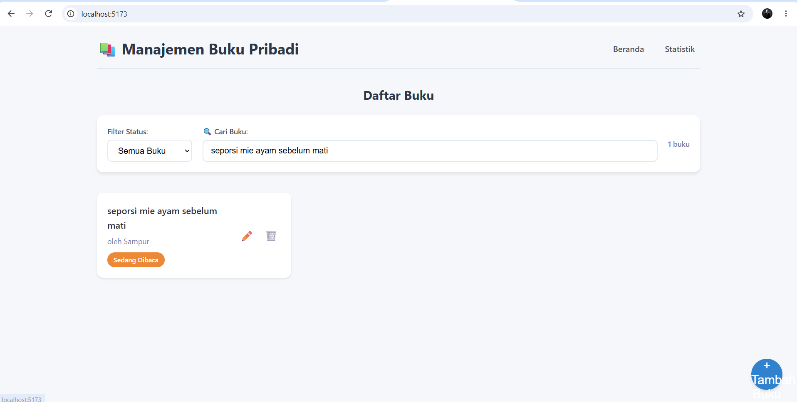
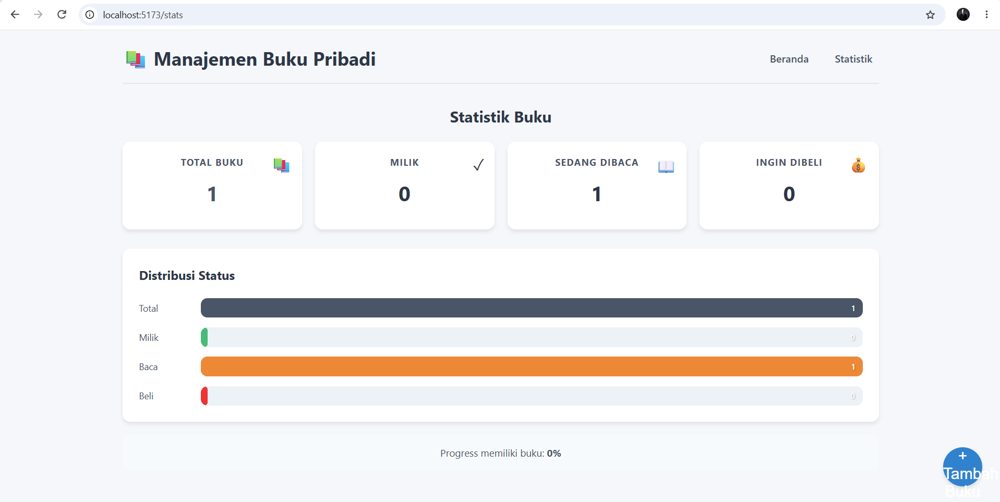
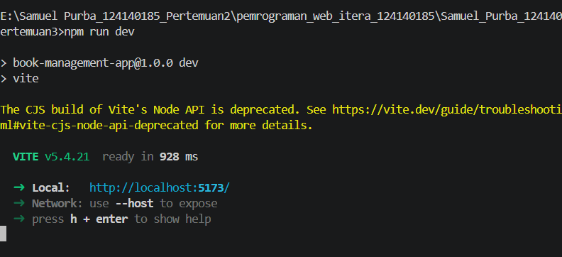
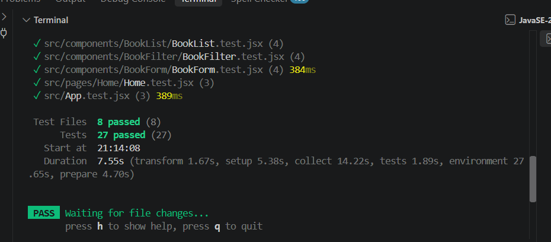

# Aplikasi Manajemen Buku Pribadi 📚

## Deskripsi Aplikasi

Aplikasi Manajemen Buku Pribadi adalah aplikasi web berbasis React yang memungkinkan pengguna untuk mencatat dan mengelola koleksi buku pribadi. Pengguna dapat menambahkan buku dengan status "Milik", "Sedang Dibaca", atau "Ingin Dibeli", serta melakukan pencarian dan filter berdasarkan status.

### Fitur Utama:
- ✅ Menambah buku baru (judul, penulis, status)
- ✅ Mengedit dan menghapus buku
- ✅ Filter buku berdasarkan status (Milik, Baca, Beli)
- ✅ Pencarian buku berdasarkan judul atau penulis
- ✅ Statistik buku dengan visualisasi
- ✅ Penyimpanan data persisten menggunakan localStorage

## Instruksi Instalasi & Cara Menjalankan

### Persyaratan
- Node.js versi 16 atau lebih tinggi
- npm atau yarn

### Langkah Instalasi

1. **Buka terminal dan navigasi ke folder project**
```bash
cd Samuel_Purba_124140185_pertemuan3
```

2. **Pasang dependencies**
```bash
npm install
```

3. **Jalankan aplikasi development**
```bash
npm run dev
```

4. **Buka browser dan akses**
```
http://localhost:5173
```

### Menjalankan Testing

```bash
# Jalankan semua test
npm test

# Jalankan test dengan UI
npm run test:ui

# Build production
npm run build
```

## Teknologi yang Digunakan

| Teknologi | Versi | Keterangan |
|-----------|-------|------------|
| React | 18.x | Library UI |
| Vite | 5.x | Build tool |
| React Router | 6.x | Navigasi multi-halaman |
| PropTypes | 15.x | Type checking |
| Vitest | 1.x | Testing framework |
| React Testing Library | 14.x | Testing React components |

## Fitur React yang Digunakan

### 1.useState & useEffect
Digunakan untuk mengelola state lokal komponen dan efek samping seperti filter pencarian.

```javascript
const [storedValue, setStoredValue] = useState(() => {
  try {
    const item = window.localStorage.getItem(key)
    return item ? JSON.parse(item) : initialValue
  } catch (error) {
    return initialValue
  }
})
```

### 2. Context API
Digunakan untuk state management global buku dengan penyimpanan otomatis ke localStorage.

```javascript
<BookProvider>
  <App />
</BookProvider>
```

### 3. React Router
Implementasi navigasi multi-halaman dengan route protection.

```javascript
<Routes>
  <Route path="/" element={<Home />} />
  <Route path="/stats" element={<Stats />} />
</Routes>
```

### 4. Custom Hooks
Dua buah custom hook yang dibuat:
- `useLocalStorage.js` - Manajemen localStorage dengan reaktivitas
- `useBookStats.js` - Perhitungan statistik buku

### 5. PropTypes
Type checking untuk semua komponen.

```javascript
BookForm.propTypes = {
  bookToEdit: PropTypes.shape({
    id: PropTypes.string,
    title: PropTypes.string,
    author: PropTypes.string,
    status: PropTypes.string
  }),
  onClose: PropTypes.func.isRequired
}
```

## Struktur Folder

```
src/
├── components/
│   ├── BookForm/         # Form untuk tambah/edit buku
│   │   ├── BookForm.jsx
│   │   └── BookForm.css
│   ├── BookList/         # Daftar buku
│   │   ├── BookList.jsx
│   │   └── BookList.css
│   └── BookFilter/       # Filter & pencarian
│       ├── BookFilter.jsx
│       └── BookFilter.css
├── pages/
│   ├── Home/             # Halaman utama
│   │   ├── Home.jsx
│   │   └── Home.css
│   └── Stats/            # Halaman statistik
│       ├── Stats.jsx
│       └── Stats.css
├── hooks/                # Custom hooks
│   ├── useLocalStorage.js
│   └── useBookStats.js
├── context/              # Context API
│   └── BookContext.jsx
├── App.jsx               # Entry point
└── setupTests.js         # Testing setup
```

## Screenshot Antarmuka

### Halaman Utama (Daftar Buku)


### Halaman Statistik


### Menjalankan Development Server


## Error Handling

Aplikasi dilengkapi dengan error handling untuk:
- Validasi input form (judul dan penulis wajib diisi)
- Feedback visual saat input kosong
- Konfirmasi penghapusan buku
- Penanganan error localStorage

## Testing

Proyek ini mencakup 27 unit test (lebih dari 5 yang disyaratkan) dengan React Testing Library & Vitest, tersebar di 8 file test:

1. **App.test.jsx** - Tests untuk komponen App utama
2. **BookForm.test.jsx** - Tests untuk form input & validasi buku
3. **BookList.test.jsx** - Tests untuk daftar buku
4. **BookFilter.test.jsx** - Tests untuk filter & pencarian
5. **Home.test.jsx** - Tests untuk halaman utama
6. **Stats.test.jsx** - Tests untuk halaman statistik
7. **useLocalStorage.test.jsx** - Tests untuk custom hook localStorage
8. **useBookStats.test.jsx** - Tests untuk custom hook statistik

### Hasil Eksekusi Test


Untuk menjalankan test:
```bash
npm test
```

## Penggunaan

Setelah menjalankan `npm run dev`, aplikasi akan terbuka di browser dengan fitur:

1. **Navigasi**: Gunakan menu di header untuk berpindah antara halaman
2. **Tambah Buku**: Klik tombol + di kanan bawah untuk membuka form
3. **Filter**: Pilih status di halaman utama untuk menerapkan filter
4. **Cari**: Ketik di kotak pencarian untuk mencari buku
5. **Statistik**: Klik "Statistik" di menu untuk melihat grafik

## Author

**Nama**: Samuel Purba  
**NIM**: 124140185  
**Mata Kuliah**: Pemrograman Web Itera

## License

MIT License