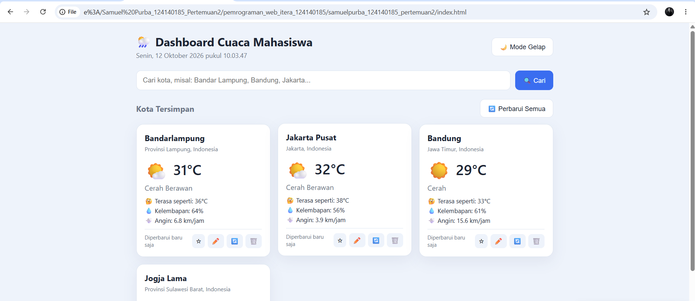
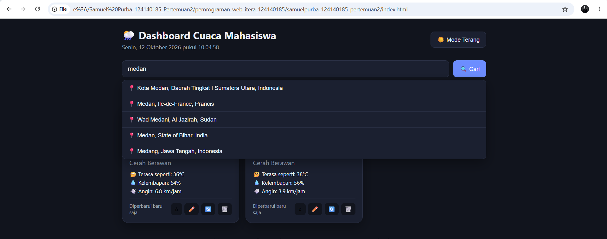
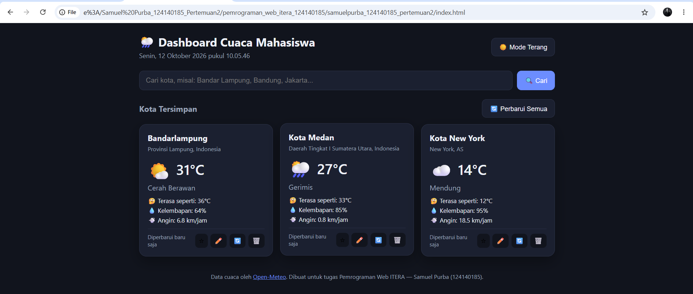

# 🌦️ Dashboard Cuaca Mahasiswa

Tugas Praktikum Pemrograman Web — Pertemuan 2
**Nama:** Samuel Purba
**NIM:** 124140185

## 📌 Deskripsi Aplikasi

Dashboard Cuaca Mahasiswa adalah aplikasi personal dashboard berbasis HTML, CSS, dan JavaScript murni (vanilla JS) yang membantu mahasiswa memantau kondisi cuaca kota-kota yang penting bagi mereka — misalnya kota tempat kuliah, kota asal, atau kota tujuan saat ingin bepergian. Data cuaca diambil secara *real-time* dari [Open-Meteo API](https://open-meteo.com) (API publik, gratis, tanpa perlu API key).

### ✨ Fitur Utama

| Fitur | Keterangan |
|---|---|
| 🔍 Cari & Tambah Kota | Cari nama kota melalui geocoding API, pilih dari daftar hasil, lalu kota otomatis ditambahkan ke dashboard beserta data cuacanya |
| ✏️ Edit Nama Kota | Setiap kota dapat diberi nama panggilan (nickname) sendiri, misalnya "Kampus" atau "Rumah" |
| 🗑️ Hapus Kota | Kota yang tidak diperlukan dapat dihapus dari dashboard |
| ⭐ Tandai Favorit | Kota favorit otomatis ditampilkan lebih dulu di dashboard |
| 🔄 Perbarui Data | Refresh manual per kota atau sekaligus semua kota; auto-refresh setiap 10 menit |
| 🌙 Mode Gelap/Terang | Tema tersimpan otomatis sesuai preferensi pengguna |
| 🕒 Jam Real-time | Menampilkan tanggal & waktu saat ini (format Indonesia) |
| 💾 Penyimpanan Lokal | Daftar kota, cache data cuaca, dan preferensi tema disimpan di `localStorage`, sehingga data tetap ada meski browser ditutup |

### 🖱️ Cara Menggunakan

1. Buka `index.html` di browser (butuh koneksi internet untuk mengambil data cuaca).
2. Ketik nama kota pada kolom pencarian, lalu tekan **Cari**.
3. Klik salah satu hasil pencarian untuk menambahkannya ke dashboard.
4. Gunakan tombol pada setiap kartu kota untuk:
   - ⭐ menandai favorit,
   - ✏️ mengubah nama tampilan,
   - 🔄 memperbarui data cuaca kota tersebut,
   - 🗑️ menghapus kota dari dashboard.
5. Gunakan tombol **🔄 Perbarui Semua** untuk memperbarui seluruh data sekaligus.
6. Gunakan tombol **🌙/☀️** di pojok kanan atas untuk mengganti tema.

### 📂 Struktur File

```
Samuel Purba_124140185_Pertemuan2/
├── index.html      # Struktur halaman
├── style.css       # Styling & tema terang/gelap
├── script.js       # Logika aplikasi (ES6+, classes, async/await)
└── README.md       # Dokumentasi
```

## 🖼️ Screenshot Aplikasi

**Mode Terang — beberapa kota tersimpan**


**Pencarian Kota — dropdown hasil geocoding**


**Mode Gelap — kota baru ditambahkan**


## 🚀 Fitur ES6+ yang Diimplementasikan

Semua fitur berada pada file [`script.js`](./script.js).

### 1. `let` dan `const`
- `const` digunakan untuk semua konfigurasi dan nilai yang tidak berubah, contoh pada baris **8–11** (`CITIES_KEY`, `CACHE_KEY`, `THEME_KEY`, `AUTO_REFRESH_MS`) dan baris **14** (`WEATHER_CODES`).
- `let` digunakan pada baris **140** untuk variabel `cities` di dalam `constructor WeatherDashboard`, karena nilainya berasal dari `localStorage` dan dapat berubah seiring proses migrasi/inisialisasi data.

### 2. Arrow Functions (lebih dari 3 implementasi)
- Baris **46–49**: `getWeatherInfo = (code, isDay) => {...}` — menerjemahkan kode cuaca WMO menjadi label & ikon.
- Baris **52–61**: `formatRelativeTime = (timestamp) => {...}` — memformat waktu relatif ("5 menit lalu").
- Baris **64–71**: `escapeHtml = (str) => ...` — mengamankan string sebelum dirender ke HTML.
- Baris **183–198**: `handleSearchSubmit = async (event) => {...}` — arrow function sebagai *class field* untuk event handler (menjaga konteks `this`).
- Baris **200–205, 207–210, 212–230, 232–236, 238–243**: seluruh event handler lain (`handleSearchResultClick`, `handleOutsideClick`, `handleCityListClick`, `handleRefreshAll`, `handleThemeToggle`) juga ditulis sebagai arrow function.
- Baris **247, 273, 283, 291, 296, 301, 311, 316**: seluruh method CRUD (`addCity`, `deleteCity`, `toggleFavorite`, `startEditCity`, `cancelEditCity`, `saveEditCity`, `refreshCityById`, `refreshCity`) menggunakan arrow function sebagai class field.
- Arrow function juga dipakai secara luas di dalam `.map()`, `.filter()`, `.some()`, dan `.sort()`, misalnya baris **343** (`sortedCities = [...this.cities].sort((a, b) => ...)`).

### 3. Template Literals
- Baris **116** dan **125** (`WeatherService`): menyusun URL API secara dinamis, contoh:
  ```js
  const url = `${this.geocodeUrl}?name=${encodeURIComponent(query)}&count=5&language=id&format=json`;
  ```
- Baris **335–401** (`renderCityList` & `renderCityCard`): seluruh markup kartu kota dirender menggunakan template literals multi-baris.
- Baris **403–421** (`renderSearchResults`): menyusun daftar hasil pencarian kota secara dinamis.
- Digunakan juga untuk pesan toast dinamis, misalnya `` `${newCity.name} ditambahkan ke dashboard` `` (baris 270).

### 4. Fungsi Asinkron (Async/Await)
- Baris **115–121**: `async searchCity(query)` pada class `WeatherService` — memanggil Geocoding API.
- Baris **123–130**: `async getCurrentWeather(latitude, longitude)` — memanggil Forecast API.
- Baris **173–179**: `async init()` — memuat data cuaca awal saat aplikasi dibuka.
- Baris **183–198**: `handleSearchSubmit = async (event) => {...}` — menangani pencarian kota secara asinkron.
- Baris **232–236**: `handleRefreshAll = async () => {...}` — memperbarui semua kota sekaligus menggunakan `Promise.all`.
- Baris **247–271**: `addCity = async (result) => {...}` — menambah kota lalu langsung mengambil data cuacanya.
- Baris **316–327**: `refreshCity = async (city) => {...}` — mengambil & menyimpan data cuaca terbaru dengan `try/catch/finally`.

### 5. Implementasi Classes
- Baris **77–103**: `class StorageManager` — mengelola seluruh operasi baca/tulis `localStorage` (daftar kota, cache cuaca, tema) menggunakan *static methods*.
- Baris **109–131**: `class WeatherService` — membungkus pemanggilan Open-Meteo API (geocoding & forecast).
- Baris **137–459**: `class WeatherDashboard` — controller utama aplikasi: menyimpan state, mengikat event, dan me-render UI.

## 💾 Penggunaan `localStorage`

| Key | Isi Data | Dikelola oleh |
|---|---|---|
| `weatherDashboard_cities_v1` | Array kota tersimpan (id, nama, koordinat, status favorit, nama panggilan) | `StorageManager.getCities()` / `saveCities()` |
| `weatherDashboard_cache_v1` | Cache hasil cuaca terakhir per kota beserta timestamp | `StorageManager.getCache()` / `saveCache()` |
| `weatherDashboard_theme_v1` | Preferensi tema (`light`/`dark`) | `StorageManager.getTheme()` / `saveTheme()` |

Dengan pendekatan ini, data pengguna (daftar kota & preferensi) tetap tersimpan meskipun browser ditutup atau di-refresh, dan cache cuaca membuat aplikasi tetap menampilkan data terakhir yang diketahui sambil memuat data terbaru.

## 🛠️ Teknologi

- HTML5, CSS3 (CSS variables untuk tema terang/gelap)
- JavaScript ES6+ (vanilla, tanpa framework/library)
- [Open-Meteo API](https://open-meteo.com) — geocoding & forecast cuaca gratis tanpa API key
- `localStorage` Web API
